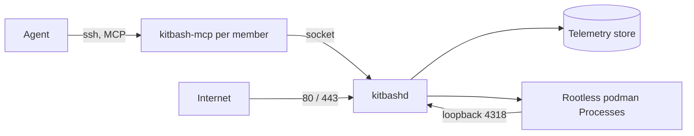

<div align="center">

<h1>kitbash</h1>

<p><strong>An operating system for AI agents: Files, Packages, Processes and Telemetry over MCP.</strong></p>

[](https://github.com/zyx1121/kitbash/actions)
[](https://github.com/zyx1121/kitbash/releases)
[](https://kitbash.zyx.tw)
[](LICENSE)

**English** | [繁體中文](README.zh-TW.md) | [简体中文](README.zh-CN.md)

</div>

An organization installs kitbash on one machine. Each member gets a Linux user, and their agent connects over SSH to an MCP endpoint that exposes the whole system. Nobody designed any part of it for a human at a terminal.

## Features

- **Files**: each member has a git-backed home, and `/org` holds shared folders, one git repository each.
- **Packages**: the agent builds source into container images. Third-party tools arrive as Packages with schemas, never as host installs.
- **Processes**: Packages run as rootless podman containers that come back after every reboot. With a domain on the host, each one gets an HTTPS address.
- **Telemetry**: every call the agent makes lands in a queryable store on the host.
- **Members and approvals**: admins add members, approve risky actions and keep per-member secrets through the same surface.

## Quick start

You need one Proxmox VE virtual machine, not an LXC container. Give it the Alpine cloud image, 4 cores, 4 GB of memory and 40 GB of disk.

1. Download `kitbashd-0.16.0-r0.<arch>.apk`, the signing key and `SHA256SUMS` from the [v0.16.0 release](https://github.com/zyx1121/kitbash/releases/tag/v0.16.0), and verify them with `sha256sum -c`.
2. On the host, as root:

   ```sh
   cp *.rsa.pub /etc/apk/keys/
   apk add kitbashd-0.16.0-r0."$(uname -m)".apk
   KITBASH_DNS=1.1.1.1 sh /usr/share/kitbash/install.sh
   kitbash-adduser alice 'ssh-ed25519 AAAA... alice@laptop' admin
   ```

3. On the member's machine:

   ```sh
   claude mcp add kitbash -- ssh alice@kitbash.example.org
   ```

Ask the agent to list its tools. It should see the 25 built-in tools. The full guide, with the domain, TLS, gateway, upgrade and state layout, is [docs/install.md](docs/install.md). You can also boot the release ISO instead of the apk.

## Usage

| Family | Tools | Does |
|--------|------:|------|
| `fs` | 4 | read, write and search Files |
| `pkg` | 4 | build and manage Packages |
| `proc` | 4 | run, list and stop Processes |
| `tel` | 2 | query Telemetry and set its retention |
| `users` | 5 | add and manage members, admins only |
| `approvals` | 3 | request and decide approvals |
| `secrets` | 3 | keep per-member secret values |

- A Process with `expose: http` gets `https://<name>.<member>.<domain>` when the host has a domain. `proc_run` returns the address.
- A Process with `expose: mcp` adds its own tools on top of the built-in 25.
- A unit with `expose: none` can declare a `schedule` and run on time.
- Admins add members with `users_create`. `kitbash-adduser` on the console is the bootstrap and recovery path.

## Configuration

Set these in `/etc/conf.d/kitbashd` or when you run `install.sh`, then restart kitbashd.

| Variable | Sets | Default |
|----------|------|---------|
| `KITBASH_DOMAIN` | the domain that turns on the reverse proxy | none |
| `KITBASH_TLS` | `acme` (kitbashd gets certificates) or `gateway` (a gateway in front ends TLS) | `acme` with a domain |
| `KITBASH_PUBLIC_ADDRESS` | the public address behind NAT or a gateway | the host's own addresses |
| `KITBASH_GATEWAY_ADDRESS` | the address that a gateway forwards from | none |
| `KITBASH_DNS` | the resolver that `install.sh` writes when the image left none | none |

## How it works



sshd runs `kitbash-mcp` as the connecting user, so a member gets the MCP surface and no shell. `kitbashd` is the resident daemon: it stores Telemetry, restores Processes at boot, mints Process tokens and serves the reverse proxy. Its receiver accepts Process traffic on loopback only, and one nftables rule drops port 4318 from every real interface. [PLAN.md](PLAN.md) holds the design.

## Limits

- One host per organization. It is not a cluster.
- Runs on Alpine in a VM. LXC is not supported, because rootless podman needs nested containers.
- `tel`, `users`, `approvals`, `secrets`, writes to `/org` and boot restore need kitbashd running.

## For AI agents

Facts for coding agents and LLM tools. The rules for changing the code are in [AGENTS.md](AGENTS.md).

- **Summary**: Agent operating system on one Alpine host, with 25 MCP tools over SSH for Files, Packages, Processes, Telemetry, members, approvals and secrets.
- **Type**: service
- **Interfaces**: MCP over SSH (`ssh <member>@<host>`, served by `kitbash-mcp`). HTTPS reverse proxy for Processes. CLI `kitbash-adduser` on the host.
- **Install**: `apk add kitbashd-0.16.0-r0.<arch>.apk && sh /usr/share/kitbash/install.sh`
- **Run**: `rc-service kitbashd start`
- **Verify**: `kitbash-mcp --version && rc-service kitbashd status`, then list tools over SSH and expect 25
- **Config**: `KITBASH_DOMAIN`, `KITBASH_TLS`, `KITBASH_PUBLIC_ADDRESS`, `KITBASH_GATEWAY_ADDRESS`, `KITBASH_DNS`
- **Secrets**: member secrets in `/var/lib/kitbash/secrets/<member>/`, root only and outside the database
- **Limits**: one Alpine VM host. Most families need kitbashd.

## Development

```sh
make build      # bin/kitbash-mcp and bin/kitbashd for this host
make test       # go test ./..., including the MCP surface in memory
make lint       # gofmt and go vet
```

Go 1.26 and git are the only requirements. `KITBASH_ROOTS`, `KITBASH_SOCKET` and `KITBASH_STORE` point a local run at a fixture tree. To release, run `make bump VERSION=X.Y.Z`, open the PR and merge it. `release.yml` then builds the apk, the ISO and the binaries for x86_64 and aarch64, boots each ISO in QEMU, and publishes the release.

## License

[MIT](LICENSE)
