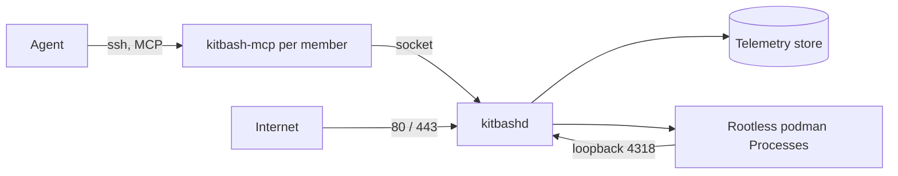

<!-- 翻译自 README.md @ docs/readme-template-v2。只翻译 "For AI agents" 之前的章节，英文版更新时一起改。 -->

<div align="center">

<h1>kitbash</h1>

<p><strong>给 AI agent 用的操作系统：通过 MCP 操作 Files、Packages、Processes 和 Telemetry。</strong></p>

[](https://github.com/zyx1121/kitbash/actions)
[](https://github.com/zyx1121/kitbash/releases)
[](https://kitbash.zyx.tw)
[](LICENSE)

[English](README.md) | [繁體中文](README.zh-TW.md) | **简体中文**

</div>

一个组织在一台机器上安装 kitbash。每位成员有一个 Linux 用户，他们的 agent 通过 SSH 连接到一个开放整个系统的 MCP 端点。这里没有任何部分是为坐在终端前的人设计的。

## 功能

- **Files**：每位成员有一个由 git 管理的主目录，`/org` 放共享文件夹，每个文件夹是一个 git repo。
- **Packages**：agent 把源码构建成容器镜像。第三方工具以附 schema 的 Package 进来，不会装在主机上。
- **Processes**：Package 以 rootless podman 容器运行，每次重启都会恢复。主机配置域名后，每个 Process 都有一个 HTTPS 地址。
- **Telemetry**：agent 的每一次调用都会记录进主机上可查询的数据库。
- **成员与审批**：管理员通过同一个界面添加成员、审批高风险操作，并保管每位成员的机密。

## 快速开始

你需要一台 Proxmox VE 虚拟机，不能是 LXC 容器。装 Alpine cloud image，给 4 核、4 GB 内存和 40 GB 硬盘。

1. 从 [v0.16.0 release](https://github.com/zyx1121/kitbash/releases/tag/v0.16.0) 下载 `kitbashd-0.16.0-r0.<arch>.apk`、签名公钥和 `SHA256SUMS`，用 `sha256sum -c` 校验。
2. 在主机上以 root 运行：

   ```sh
   cp *.rsa.pub /etc/apk/keys/
   apk add kitbashd-0.16.0-r0."$(uname -m)".apk
   KITBASH_DNS=1.1.1.1 sh /usr/share/kitbash/install.sh
   kitbash-adduser alice 'ssh-ed25519 AAAA... alice@laptop' admin
   ```

3. 在成员自己的电脑上：

   ```sh
   claude mcp add kitbash -- ssh alice@kitbash.example.org
   ```

请 agent 列出它的工具，应该会看到 25 个内置工具。完整说明(域名、TLS、gateway、升级和数据位置)在 [docs/install.md](docs/install.md)。也可以改用 release 的 ISO 启动安装。

## 使用方法

| 类别 | 工具数 | 作用 |
|------|------:|------|
| `fs` | 4 | 读写和搜索 Files |
| `pkg` | 4 | 构建和管理 Packages |
| `proc` | 4 | 运行、列出和停止 Processes |
| `tel` | 2 | 查询 Telemetry 和设置保留期 |
| `users` | 5 | 添加和管理成员，仅限管理员 |
| `approvals` | 3 | 提交和决定审批 |
| `secrets` | 3 | 保管每位成员的机密值 |

- 主机有域名时，`expose: http` 的 Process 会得到 `https://<name>.<member>.<domain>`，`proc_run` 会返回这个地址。
- `expose: mcp` 的 Process 会在内置 25 个工具之外加上自己的工具。
- `expose: none` 的 unit 可以声明 `schedule`，定时运行。
- 管理员用 `users_create` 添加成员。控制台上的 `kitbash-adduser` 用于初始化和救援。

## 配置

在 `/etc/conf.d/kitbashd` 或运行 `install.sh` 时设置，然后重启 kitbashd。

| 变量 | 作用 | 默认值 |
|------|------|--------|
| `KITBASH_DOMAIN` | 开启反向代理的域名 | 无 |
| `KITBASH_TLS` | `acme`(kitbashd 自己获取证书)或 `gateway`(由前面的 gateway 处理 TLS) | 有域名时为 `acme` |
| `KITBASH_PUBLIC_ADDRESS` | 在 NAT 或 gateway 后面时的公网地址 | 主机自己的地址 |
| `KITBASH_GATEWAY_ADDRESS` | gateway 转发来源的地址 | 无 |
| `KITBASH_DNS` | 镜像没有 DNS 时 `install.sh` 写入的解析器 | 无 |

## 工作原理



sshd 以连接用户的身份运行 `kitbash-mcp`，所以成员只拿到 MCP 界面，没有 shell。`kitbashd` 是常驻的 daemon：它存储 Telemetry、启动时恢复 Processes、签发 Process 令牌，并提供反向代理。它只在 loopback 接收 Process 的流量，一条 nftables 规则会拦截所有物理接口上的 4318 端口。设计写在 [PLAN.md](PLAN.md)。

## 限制

- 一个组织一台主机，不是集群。
- 在虚拟机里的 Alpine 上运行，不支持 LXC，因为 rootless podman 需要嵌套容器。
- `tel`、`users`、`approvals`、`secrets`、写入 `/org` 和启动恢复都需要 kitbashd 在运行。

## 其他

给 AI agent 的结构化信息与开发说明见[英文版](README.md#for-ai-agents)。

## 许可证

[MIT](LICENSE)
