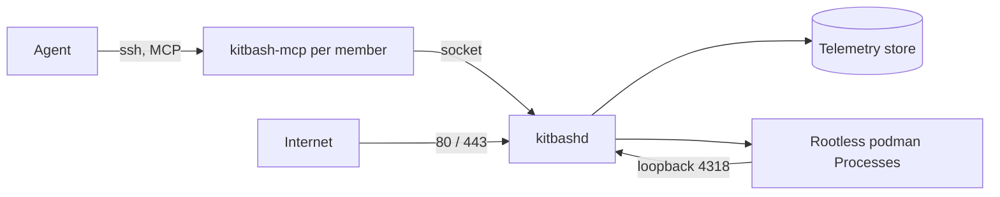

<!-- 翻譯自 README.md @ docs/readme-template-v2。只翻 "For AI agents" 以上的章節，英文版更新時一起改。 -->

<div align="center">

<h1>kitbash</h1>

<p><strong>給 AI agent 用的作業系統：透過 MCP 操作 Files、Packages、Processes 和 Telemetry。</strong></p>

[](https://github.com/zyx1121/kitbash/actions)
[](https://github.com/zyx1121/kitbash/releases)
[](https://kitbash.zyx.tw)
[](LICENSE)

[English](README.md) | **繁體中文** | [简体中文](README.zh-CN.md)

</div>

一個組織在一台機器上安裝 kitbash。每位成員有一個 Linux 使用者，他們的 agent 透過 SSH 連到一個開放整個系統的 MCP 端點。這裡沒有任何部分是為坐在終端機前的人設計的。

## 功能

- **Files**：每位成員有一個由 git 管理的家目錄，`/org` 放共用資料夾，每個資料夾是一個 git repo。
- **Packages**：agent 把原始碼建成容器映像檔。第三方工具以附 schema 的 Package 進來，不會裝在主機上。
- **Processes**：Package 以 rootless podman 容器執行，每次重開機都會恢復。主機設定網域後，每個 Process 都有一個 HTTPS 網址。
- **Telemetry**：agent 的每一次呼叫都會記進主機上可查詢的資料庫。
- **成員與核准**：管理員透過同一個介面新增成員、核准高風險操作，並保管每位成員的機密。

## 快速開始

你需要一台 Proxmox VE 虛擬機，不能是 LXC 容器。裝 Alpine cloud image，給 4 核心、4 GB 記憶體和 40 GB 硬碟。

1. 從 [v0.16.0 release](https://github.com/zyx1121/kitbash/releases/tag/v0.16.0) 下載 `kitbashd-0.16.0-r0.<arch>.apk`、簽章公鑰和 `SHA256SUMS`，用 `sha256sum -c` 驗證。
2. 在主機上以 root 執行：

   ```sh
   cp *.rsa.pub /etc/apk/keys/
   apk add kitbashd-0.16.0-r0."$(uname -m)".apk
   KITBASH_DNS=1.1.1.1 sh /usr/share/kitbash/install.sh
   kitbash-adduser alice 'ssh-ed25519 AAAA... alice@laptop' admin
   ```

3. 在成員自己的電腦上：

   ```sh
   claude mcp add kitbash -- ssh alice@kitbash.example.org
   ```

請 agent 列出它的工具，應該會看到 25 個內建工具。完整說明(網域、TLS、gateway、升級和資料位置)在 [docs/install.md](docs/install.md)。也可以改用 release 的 ISO 開機安裝。

## 使用方式

| 類別 | 工具數 | 作用 |
|------|------:|------|
| `fs` | 4 | 讀寫和搜尋 Files |
| `pkg` | 4 | 建立和管理 Packages |
| `proc` | 4 | 執行、列出和停止 Processes |
| `tel` | 2 | 查詢 Telemetry 和設定保留期間 |
| `users` | 5 | 新增和管理成員，僅限管理員 |
| `approvals` | 3 | 提出和決定核准 |
| `secrets` | 3 | 保管每位成員的機密值 |

- 主機有網域時，`expose: http` 的 Process 會得到 `https://<name>.<member>.<domain>`，`proc_run` 會回傳這個網址。
- `expose: mcp` 的 Process 會在內建 25 個工具之外加上自己的工具。
- `expose: none` 的 unit 可以宣告 `schedule`，定時執行。
- 管理員用 `users_create` 新增成員。主控台上的 `kitbash-adduser` 是初始化和救援用的。

## 設定

在 `/etc/conf.d/kitbashd` 或執行 `install.sh` 時設定，然後重啟 kitbashd。

| 變數 | 作用 | 預設 |
|------|------|------|
| `KITBASH_DOMAIN` | 開啟反向代理的網域 | 無 |
| `KITBASH_TLS` | `acme`(kitbashd 自己取得憑證)或 `gateway`(由前面的 gateway 處理 TLS) | 有網域時為 `acme` |
| `KITBASH_PUBLIC_ADDRESS` | 在 NAT 或 gateway 後面時的公開位址 | 主機自己的位址 |
| `KITBASH_GATEWAY_ADDRESS` | gateway 轉發來源的位址 | 無 |
| `KITBASH_DNS` | 映像檔沒有 DNS 時 `install.sh` 寫入的解析器 | 無 |

## 運作方式



sshd 以連線的使用者身分執行 `kitbash-mcp`，所以成員只拿到 MCP 介面，沒有 shell。`kitbashd` 是常駐的 daemon：它儲存 Telemetry、開機時恢復 Processes、核發 Process 權杖，並提供反向代理。它只在 loopback 接收 Process 的流量，一條 nftables 規則會擋掉所有實體介面上的 4318 port。設計寫在 [PLAN.md](PLAN.md)。

## 限制

- 一個組織一台主機，不是 cluster。
- 在 VM 裡的 Alpine 上執行，不支援 LXC，因為 rootless podman 需要巢狀容器。
- `tel`、`users`、`approvals`、`secrets`、寫入 `/org` 和開機恢復都需要 kitbashd 在執行。

## 其他

給 AI agent 的結構化資訊與開發說明在[英文版](README.md#for-ai-agents)。

## 授權

[MIT](LICENSE)
